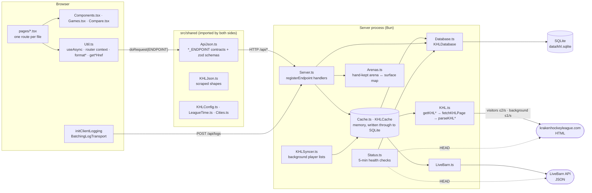
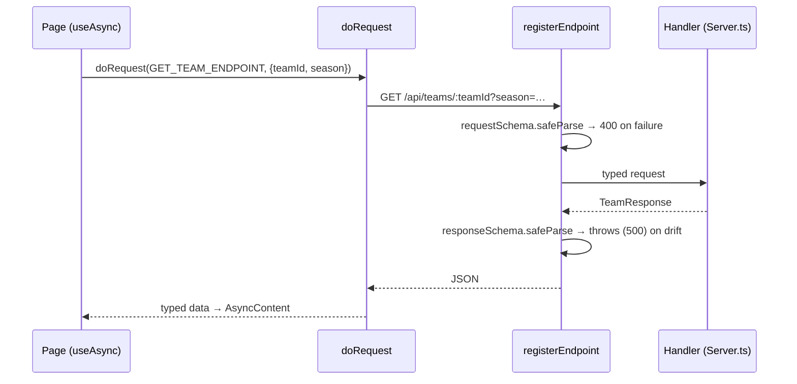
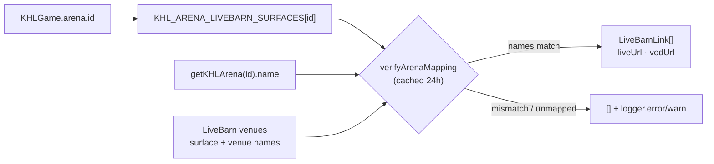
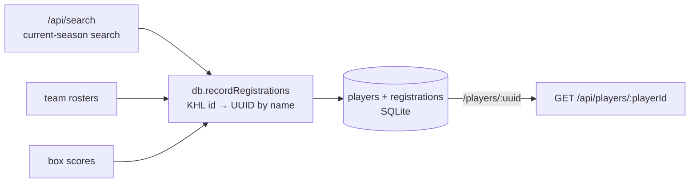
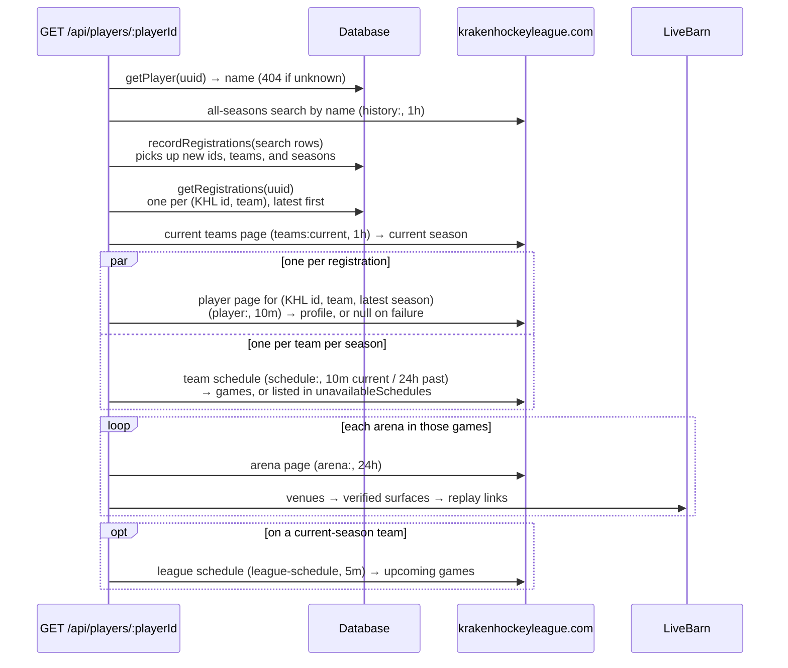
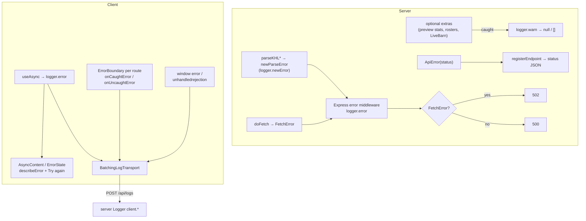
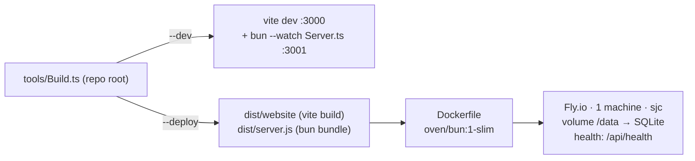

# KHL+ architecture

KHL+ is a faster, friendlier front end for [krakenhockeyleague.com](https://krakenhockeyleague.com). The league has no API, so a Bun/Express server scrapes its HTML pages, caches them in memory and SQLite, joins them with LiveBarn's venue data and a small SQLite database, and serves typed JSON to a React single-page app.

## Components

| Component | Files | Responsibility |
| --- | --- | --- |
| Scraper | `src/server/KHL.ts` | One `getKHL*` per league page. Each fetches through `fetchKHLPage`, which rate-limits `doFetch` per lane (2 requests a second for visitors, 1 for background work run through `runInKHLBackground`), and hands the DOM to a pure `parseKHL*` that returns a `KHLJson` shape or throws `newParseError`. Knows nothing about caching or the API. |
| LiveBarn client | `src/server/LiveBarn.ts` | Fetches the venues list (validated by `LiveBarnJson.ts`). The live/VOD watch URLs are built by `src/shared/LiveBarn.ts`, so the client can link scoresheet events to their moment in a replay. |
| Arena mapping | `src/server/Arenas.ts` | Hand-maintained map from KHL arena id to LiveBarn surfaces, display name, and city. The two sites disagree on names and addresses, so nothing here is inferred. |
| Cache | `src/server/Cache.ts` | `KHLCache`: memoizes loaded KHL and LiveBarn data by key and TTL, sharing in-flight loads, and writes each value through to SQLite so it survives restarts. A stored value is read back through the caller's zod schema; one that no longer matches is loaded again. |
| Background sync | `src/server/KHLSyncer.ts` | Keeps every season's player list (`players:<season>`) cached, one season at a time, current season first, refreshing each halfway through its TTL. A list reads every team's stats page, so `/api/players` only ever reads the cache. |
| API server | `src/server/Server.ts` | Express app. Picks each page's TTL and schema, composes scraped pages into API responses, enriches them (LiveBarn links, logos, preview stats, rosters), serves the built SPA, and maps errors to status codes. |
| Database | `src/server/Database.ts` | `bun:sqlite` with append-only migrations. Stores the person-level player identity the KHL lacks, status-check history, and the cache's entries. |
| Status monitor | `src/server/Status.ts` | On boot and every 5 minutes, checks the app/DB, the KHL site, and LiveBarn, records results, and prunes to 90 days. Serves `/api/status` and `DEPLOY_INFO` (git commit). |
| Shared contracts | `src/shared/*` | `ApiJson.ts` defines every endpoint (`uri`, `method`, and request and response zod schemas). `KHLJson.ts` is the scraper's output vocabulary. `KHLConfig.ts` holds strings, URLs, league settings, and limits. `LeagueTime.ts` is the only place that knows the league's time zone, and it estimates when a scoresheet event happened from its period and clock (`getGameEventClockTime`). `LiveBarn.ts` builds watch URLs. |
| Client shell | `src/client/App.tsx`, `Util.ts` | Hand-rolled router over `history` (a `ROUTES` table and `matchRoute`), `AppContext`, per-route `ErrorBoundary`, React root error hooks, and client logging. |
| UI kit | `Components.tsx`, `Games.tsx`, `Compare.tsx`, `Styles.css` | Generic controls built on Base UI (`Picker`, `SegmentedControl`, `Hint`, `AsyncContent`, `PageShell`), game-specific views (`GameTable`, `GameCards`, `TeamForm`), and the matchup comparison bars. |
| Pages | `src/client/pages/*.tsx` | One `Route` per file: `/`, `/games`, `/games/:gameId`, `/players`, `/players/:playerId`, `/teams`, `/teams/:teamId`, `/rinks/:arenaId`, `/matchup`, `/about`, `/help`, `/api` (docs rendered from the `ApiJson.ts` endpoint objects), `/status`, and `/admin` (dev only). |

## Seams

These are the boundaries where one part of the system meets another. Most changes stay on one side of a seam. A change that crosses one usually has to touch both sides together.

### 1. Client ↔ server: `ApiJson.ts` endpoint contracts

Both sides import the same `*_ENDPOINT` object, so a route, its parameters, and its response type can't drift silently: the server validates the request on the way in and its own response on the way out. To add an API, define the endpoint in `ApiJson.ts`, register it in `Server.ts`, and call it with `doRequest` inside `useAsync`. Every endpoint also needs a `name`, a `description`, and an `exampleRequest`, and its request fields need `.describe()`. The `/api` docs page renders all of that, plus TypeScript types generated from the zod schemas, for each endpoint in `API_DOCS_SECTIONS`. `ApiDocs.test.ts` fails if an endpoint is in neither that list nor its internal list.

In dev, Vite serves the client on `:3000` and proxies `/api` to the server on `:3001`. In production, one process serves both: `express.static(dist/website)` with an `index.html` fallback for client routes.

### 2. Scraper ↔ server: `KHLJson.ts` and `KHLCache`

`KHL.ts` turns HTML into `KHLJson` types and does nothing else. `Server.ts` never touches the DOM, and `KHL.ts` never caches or builds API responses. Every scraper call goes through `cache.cached(key, ttl, schema, load)`. That method:

- shares one in-flight promise between concurrent callers,
- drops failures so the next request retries,
- takes a TTL per key: `getSeasonTtl(isCurrentSeason)` caches the current season for 10 minutes and past seasons for 24 hours. An optional `getTtlMs` can also set the TTL from the loaded value,
- writes each loaded value to SQLite (`cache_entries`), and on a memory miss reads an unexpired one back through `schema`, so a deploy doesn't start from a cold cache.

When the league changes its markup, the fix belongs in the matching `parseKHL*`. When a response needs new data, add a field to `KHLJson.ts` and then use it from `Server.ts`.

The KHL site starts returning 403s at a few requests a second, counting all of ours together, so `fetchKHLPage` has a rate limiter for each lane. A fetch for a visitor waiting on an uncached page gets up to 2 a second. Background work (anything inside `runInKHLBackground`) gets 1 a second on its own limiter, so visitors never queue behind it. Anything that reads many pages runs in the background instead of in a request. `KHLSyncer` builds each season's player list from about 175 team pages in the background lane, and refreshes it halfway through its TTL (12 hours for the current season, 14 days for past ones), so a failed refresh still leaves the last list in place. `/api/players` serves the cached list or a 503 while the first sync runs, and never fetches itself.

### 3. KHL ↔ LiveBarn: `Arenas.ts` with runtime verification

The two external sites share no ids. `Arenas.ts` is the join table. It records the expected names on both sides, so if either site renames or reassigns an id, the link is dropped and logged instead of pointing viewers at the wrong rink. Watch URLs use league-local date and time, which works because every mapped venue is in the league's time zone.

### 4. Scraped ids ↔ stable people: `Database.ts`

The KHL issues a new player id each time a player registers, so one person has many ids, including several on one team when they re-register with it. A player can also keep one id across several teams, so a registration is a (KHL player id, team) pair, keyed by `getPlayerRegistrationKey`. Search results, rosters, and box scores all pass through `db.recordRegistrations(...)`, which matches each KHL id to a person-level UUID by normalized name (`normalizePlayerName`). `/players/:playerId` uses that UUID and fans out to all of the person's registrations. The database lives on a Fly volume (`KHL_DB_PATH`), so those UUIDs survive deploys. Migrations in `MIGRATIONS` are append-only, and their order is tracked with `PRAGMA user_version`.

#### Building a player profile

A player gets a UUID the first time any page shows them, and their profile page then rebuilds everything from the KHL by name:

`GET /api/players/:playerId` fetches in this order. Each step needs the one before it: the search finds the registrations, and the registrations name the player pages and schedules to load.

Opponent logos come from the teams page already loaded, not a page per season, to stay under the KHL site's 403 threshold. The page also requests `GET /api/players/:playerId/activity` once, separately, since it's slower. That one response feeds the activity feed, the games the player sat out, and the badges' penalty trend. That request repeats the first steps (from cache), then reads each recent final game's stats page, to see whether the player dressed, and its box score for their goals, assists, and penalties. The integrity report (`/players/:playerId?integrity`) draws this graph for one player, from the name search to each registration's player page and schedules. Each node's color says whether it matches the KHL and its glyph says whether it's cached, and the report lists the problems and shows any node's details.

### 5. League time: `LeagueTime.ts`

The schedule lists local dates and times with no zone. `toLeagueInstant` converts them to ISO instants at parse time, `getLeagueDayKey` buckets instants into league days (used for `/api/games?date=` and status history), and `getGameEndsAt` / `isGameInProgress` apply `LEAGUE.GAME_DURATION_MINUTES`. Both the server and the client import these functions, so "today" and "live now" mean the same thing on both sides.

### 6. Failure handling across the stack

A 502 means the KHL or LiveBarn site failed. A 500 means a bug in our code. Optional enrichments never fail a whole page. Client logs are batched, flushed when the tab is hidden, and re-logged on the server under `client.<context>`, so one log stream covers both sides.

## Build and deploy

`pnpm start` / `build` / `deploy` all go through the repo's `tools/Build.ts`. The production image contains only Bun and the two bundled artifacts. `tools/Benchmark.ts` is dev-only: it uses Puppeteer to time KHL+ against the league's own site, runs from the CLI or from `/admin` via `/api/admin/benchmark`, and is imported lazily so it stays out of the production bundle.
