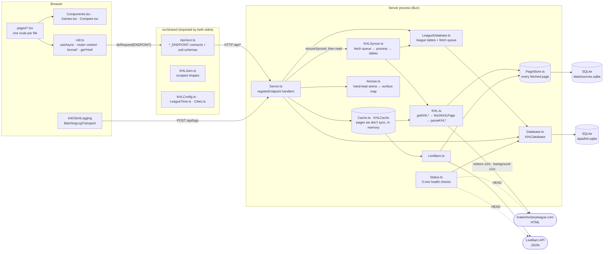
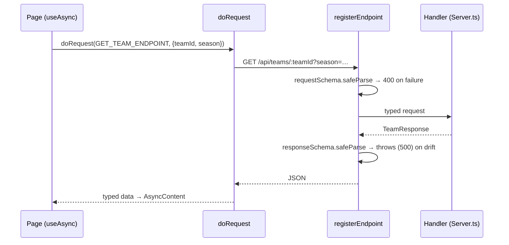
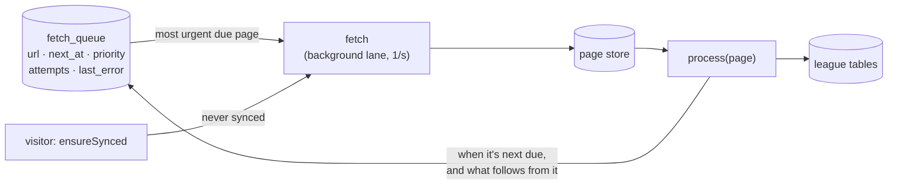
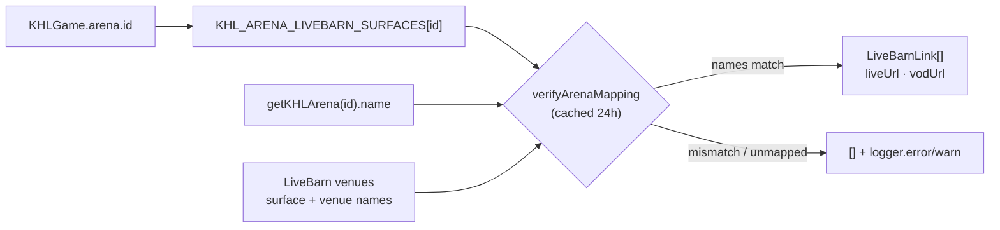
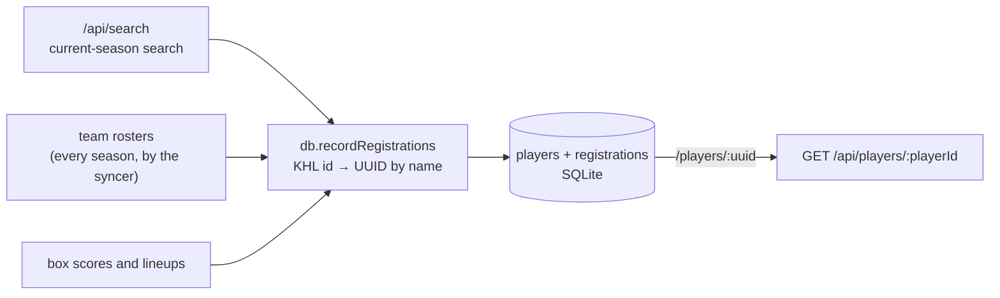
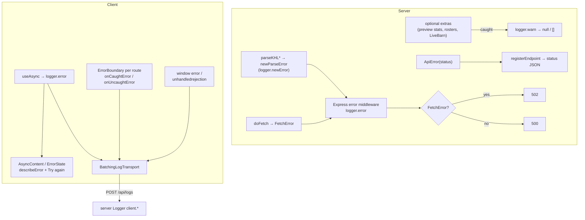
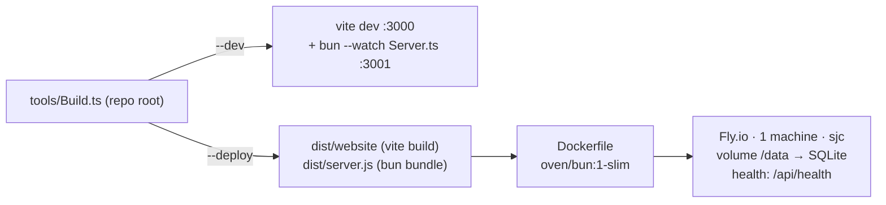

# KHL+ architecture

KHL+ is a faster, friendlier front end for [krakenhockeyleague.com](https://krakenhockeyleague.com). The league has no API, so a Bun/Express server keeps its own copy of the league: a background syncer fetches the KHL's HTML pages, stores each one, and processes it into SQLite tables, which the API reads, joined with LiveBarn's venue data, to serve typed JSON to a React single-page app.

## Components

| Component | Files | Responsibility |
| --- | --- | --- |
| Scraper | `src/server/KHL.ts` | One `getKHL*` per league page. Each fetches through `fetchKHLPage`, which rate-limits `doFetch` per lane (2 requests a second for visitors, 1 for background work run through `runInKHLBackground`), and hands the DOM to a pure `parseKHL*` that returns a `KHLJson` shape or throws `newParseError`. Knows nothing about caching or the API. |
| LiveBarn client | `src/server/LiveBarn.ts` | Fetches the venues list (validated by `LiveBarnJson.ts`). The live/VOD watch URLs are built by `src/shared/LiveBarn.ts`, so the client can link scoresheet events to their moment in a replay. |
| Arena mapping | `src/server/Arenas.ts` | Hand-maintained map from KHL arena id to LiveBarn surfaces, display name, and city. The two sites disagree on names and addresses, so nothing here is inferred. |
| Page store | `src/server/PageStore.ts` | Every page fetched from the KHL (`khl_pages`) and LiveBarn (`livebarn_responses`), as fetched and gzipped, in its own SQLite file (`KHL_SOURCES_DB_PATH`). It's a copy of the sources, not a cache: nothing expires, and a refetch replaces a page, recording whether it changed. Fetches read through it (`readPage`, which also parses), so a recent enough stored page saves a fetch. A fetched page replaces the stored copy only once it parses; one that doesn't goes to `failed_pages`, and a stale fallback can still serve the last good copy. Concurrent fetches of one page share a request, fetches time out after 15 seconds, and one-off searches aren't stored. |
| Sync | `src/server/KHLSyncer.ts`, `SyncPages.ts` | Keeps the league tables in sync with the KHL through a persistent fetch queue (`fetch_queue`): every page it keeps, when it's next due, its priority, attempts, and last error. The loop takes the most urgent due page, fetches it, processes it into tables, and schedules it and whatever follows from it. Visitors call `ensureSynced`, which syncs a page that never was, so every stored page of these kinds is processed whoever fetched it. The loop runs in production, and in dev only with `KHL_SYNC=1`. In dev, `/admin` can also turn on offline mode (`setOfflineMode`), where nothing is fetched and only stored pages are served, and can replace dev's databases with snapshots of production's (`tools/PullProdData.ts` downloads them, and `replaceDatabaseContents` copies them into the open connections). See seam 2. |
| League tables | `src/server/LeagueDatabase.ts`, `GameRecords.ts` | `seasons`, `divisions`, `teams` (with which page named each, since a teams page outranks a schedule, box score, roster, or search), `arenas`, `schedule_games`, `team_seasons` and `roster_stats`, `player_profiles`, and the games: `games`, `game_teams`, `game_periods`, `game_events` (goals and penalties in scoresheet order), `game_event_players`, and `game_lineups`. Rows refer to each other by id; reads join in names and rebuild the scraped shapes (`KHLJson`) the API is built from. Stat columns and values, which each page defines, are JSON. `GameRecords.ts` holds when a game has settled, is complete, and is due for another look. |
| Cache | `src/server/Cache.ts` | `KHLCache`: parsed pages the syncer doesn't keep (standings, scoreboards, previews, arenas, LiveBarn, searches), in memory by key and TTL, sharing in-flight loads. |
| API server | `src/server/Server.ts` | Express app. Reads the league tables (`getTeamsPage`, `getSchedule`, `getTeamStats`, `getPlayer`, `getBoxScore`, `getGameStats` sync a page that never was, then read), composes them into API responses, enriches them (LiveBarn links, logos, preview stats, rosters), serves the built SPA, and maps errors to status codes. |
| Database | `src/server/Database.ts` | `bun:sqlite` with append-only migrations. Stores the person-level player identity the KHL lacks and status-check history, and holds the league tables (`db.league`). A new KHL id whose name matches one player goes through `acceptNameMatch` (its criteria are a TODO; it accepts every match for now), and each such match is recorded in `name_matches` for review. Fetched pages are in a separate file (see Page store), since they can always be fetched again and these can't. |
| Status monitor | `src/server/Status.ts` | On boot and every 5 minutes, checks the app/DB, the KHL site, and LiveBarn, records results, and prunes to 90 days. Serves `/api/status` and `DEPLOY_INFO` (git commit). |
| Shared contracts | `src/shared/*` | `ApiJson.ts` defines every endpoint (`uri`, `method`, and request and response zod schemas). `KHLJson.ts` is the scraper's output vocabulary. `KHLConfig.ts` holds strings, URLs, league settings, and limits. `LeagueTime.ts` is the only place that knows the league's time zone, and it estimates when a scoresheet event happened from its period and clock (`getGameEventClockTime`). `LiveBarn.ts` builds watch URLs. |
| Client shell | `src/client/App.tsx`, `Util.ts` | Hand-rolled router over `history` (a `ROUTES` table and `matchRoute`), `AppContext`, per-route `ErrorBoundary`, React root error hooks, and client logging. |
| UI kit | `Components.tsx`, `Games.tsx`, `Compare.tsx`, `Styles.css` | Generic controls built on Base UI (`Picker`, `SegmentedControl`, `Hint`, `AsyncContent`, `PageShell`), game-specific views (`GameTable`, `GameCards`, `TeamForm`), and the matchup comparison bars. |
| Pages | `src/client/pages/*.tsx` | One `Route` per file: `/`, `/games`, `/games/:gameId`, `/players`, `/players/:playerId`, `/teams`, `/teams/:teamId`, `/rinks/:arenaId`, `/matchup`, `/about`, `/help`, `/api` (docs rendered from the `ApiJson.ts` endpoint objects), `/status`, and `/admin` (dev only). |

## Seams

These are the boundaries where one part of the system meets another. Most changes stay on one side of a seam. A change that crosses one usually has to touch both sides together.

### 1. Client ↔ server: `ApiJson.ts` endpoint contracts

Both sides import the same `*_ENDPOINT` object, so a route, its parameters, and its response type can't drift silently: the server validates the request on the way in and its own response on the way out. To add an API, define the endpoint in `ApiJson.ts`, register it in `Server.ts`, and call it with `doRequest` inside `useAsync`. Every endpoint also needs a `name`, a `description`, and an `exampleRequest`, and its request fields need `.describe()`. The `/api` docs page renders all of that, plus TypeScript types generated from the zod schemas, for each endpoint in `API_DOCS_SECTIONS`. `ApiDocs.test.ts` fails if an endpoint is in neither that list nor its internal list.

In dev, Vite serves the client on `:3000` and proxies `/api` to the server on `:3001`. In production, one process serves both: `express.static(dist/website)` with an `index.html` fallback for client routes.

### 2. KHL ↔ league tables: `KHLSyncer` and the fetch queue

`KHL.ts` turns HTML into `KHLJson` types and does nothing else: each `getKHL*` fetches through `fetchKHLPage` (rate-limited, timed out, read through the page store) and hands the DOM to a pure `parseKHL*`. When the league changes its markup, the fix belongs in the matching `parseKHL*`; bump `PROCESSING_VERSION` if what's derived from a page changes, and the syncer reprocesses every stored page without fetching.

The KHL site starts returning 403s at a few requests a second, counting all of ours together, so `fetchKHLPage` has a rate limiter for each lane: up to 2 a second for visitors, and 1 a second for background work (anything inside `runInKHLBackground`) on its own limiter, so visitors never queue behind it.

The pages behind the site (teams, schedules, team stats, player pages, and games) are kept by `KHLSyncer`. Each is a row in `fetch_queue`, in the main database next to the tables processing writes:

Processing a page schedules what follows from it:

| Page | Processing queues | Due again |
| --- | --- | --- |
| The default teams page | Every season's teams page; marks the current season | In a day |
| A season's teams page | Each team's schedule and stats | In a day (current season), 30 days (past) |
| A schedule | Each game, for when it should have settled | When its next game settles, or in 6 hours (current) / 30 days (past) |
| A team's stats | Each rostered player's page, as of their latest season | In a day / 30 days, or when a game of theirs completes |
| A player's page | | In a day / 30 days, or when a game they dressed for completes |
| A game (box score and stats) | When complete (summary and both lineups posted): both teams' stats, and the pages of the players who dressed | Every 10 minutes for 2 days until complete; then in 30 days |

A completed game brings its teams' and players' pages forward only if they were synced before it was posted: since the last look if it was seen incomplete, or by its settle time otherwise, so a first sync doesn't fetch them twice. The loop takes the most urgent due page by priority (how many seasons before the current one; teams pages first) and then due time, so the current season, including after-game refreshes, always comes before past seasons. With nothing due, it sleeps until the next page is, up to 5 minutes. A failed fetch waits 30 minutes (a day for past seasons); a page that fetched but didn't parse waits for its next refresh, since fetching it again won't help until the page or the parser changes. All of this lives in the table, so a restart or deploy carries on where it left off.

Visitors read the tables. A getter like `getSchedule` calls `syncer.ensureSynced(page)`, which syncs a page that never was (from the stored copy, fetched if there isn't one) and queues it, so the syncer keeps it fresh from then on; a page that's failing and waiting to be retried is a 502 without another fetch. `/api/players` is a query on `roster_stats`, or a 503 before a season has any.

### 3. KHL ↔ LiveBarn: `Arenas.ts` with runtime verification

The two external sites share no ids. `Arenas.ts` is the join table. It records the expected names on both sides, so if either site renames or reassigns an id, the link is dropped and logged instead of pointing viewers at the wrong rink. Watch URLs use league-local date and time, which works because every mapped venue is in the league's time zone.

### 4. Scraped ids ↔ stable people: `Database.ts`

The KHL issues a new player id each time a player registers, so one person has many ids, including several on one team when they re-register with it. A player can also keep one id across several teams, so a registration is a (KHL player id, team) pair, identified by a `RegistrationKey` (`toRegistrationKey`), which is how one is passed around, e.g. to `getPlayer`. Search results, rosters, and box scores all pass through `db.recordRegistrations(...)`, which matches each KHL id to a person-level UUID by normalized name (`normalizePlayerName`). `/players/:playerId` uses that UUID and fans out to all of the person's registrations. The database lives on a Fly volume (`KHL_DB_PATH`), so those UUIDs survive deploys. Migrations in `MIGRATIONS` are append-only, and their order is tracked with `PRAGMA user_version`.

#### Building a player profile

A player gets a UUID the first time a roster, box score, or search shows them. The syncer reads every season's rosters, so the database holds each person's registrations across seasons, and a profile is built from the league tables, without searching the KHL:

`GET /api/players/:playerId` reads the player's registrations, then each registration's player page as of its latest season (`player_profiles`) and each team-season's schedule (`schedule_games`), syncing any that never were; a schedule that's failing is listed in `unavailableSchedules`. Replay links come from the arena pages and LiveBarn venues (memory cache), and upcoming games from the league schedule. The page also requests `GET /api/players/:playerId/activity` once. That one response feeds the activity feed, the games the player sat out, and the badges' penalty trend: it queries the games tables for the recent finished games, goals, assists, and penalties by the player's KHL ids, and lineups for whether they dressed. The integrity report (`/players/:playerId?integrity`) still searches the KHL by name, since it checks what we've stored against the KHL, and its check fetches the KHL's page without storing it.

### 5. League time: `LeagueTime.ts`

The schedule lists local dates and times with no zone. `toLeagueInstant` converts them to ISO instants at parse time, `getLeagueDayKey` buckets instants into league days (used for `/api/games?date=` and status history), and `getGameEndsAt` / `isGameInProgress` apply `LEAGUE.GAME_DURATION_MINUTES`. Both the server and the client import these functions, so "today" and "live now" mean the same thing on both sides.

### 6. Failure handling across the stack

A 502 means the KHL or LiveBarn site failed. A 500 means a bug in our code. Optional enrichments never fail a whole page. Client logs are batched, flushed when the tab is hidden, and re-logged on the server under `client.<context>`, so one log stream covers both sides.

## Build and deploy

`pnpm start` / `build` / `deploy` all go through the repo's `tools/Build.ts`. The production image contains only Bun and the two bundled artifacts. `tools/Benchmark.ts` is dev-only: it uses Puppeteer to time KHL+ against the league's own site, runs from the CLI or from `/admin` via `/api/admin/benchmark`, and is imported lazily so it stays out of the production bundle.
