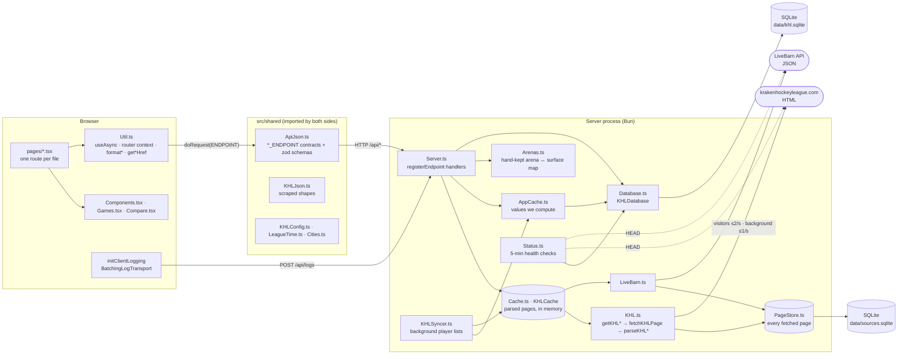
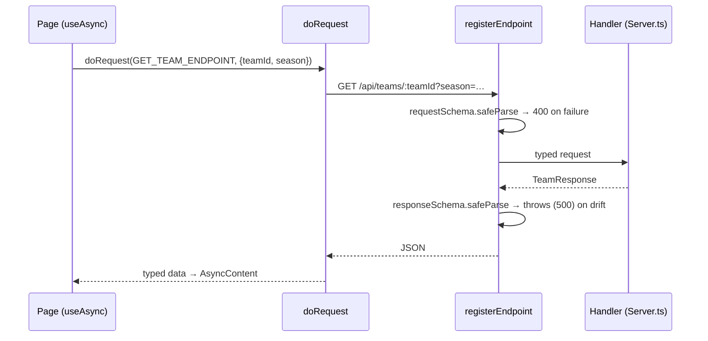
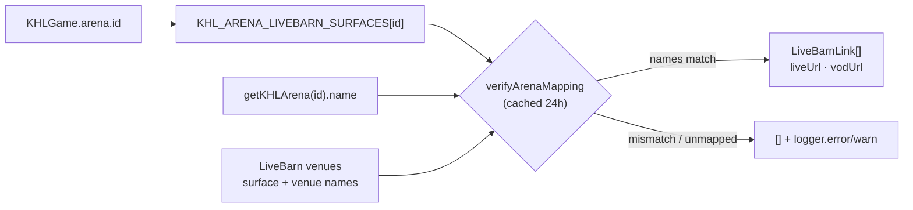
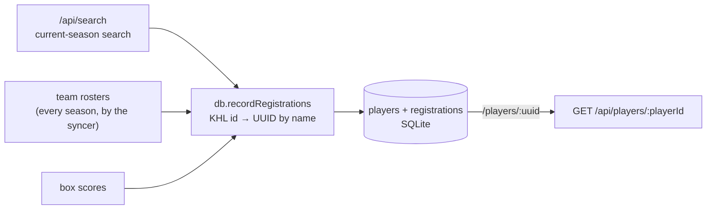
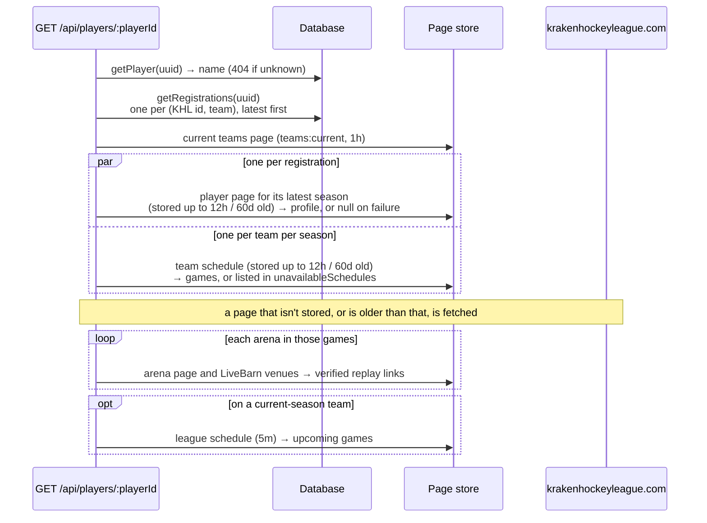
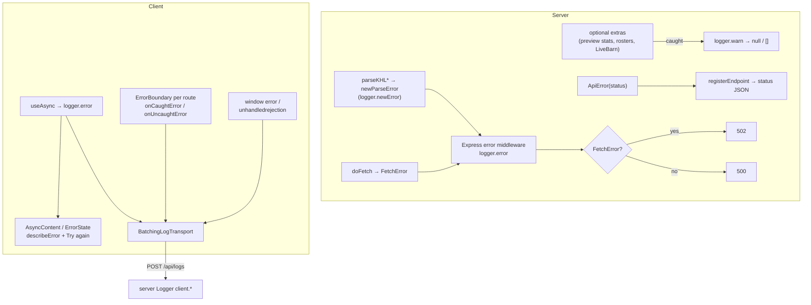
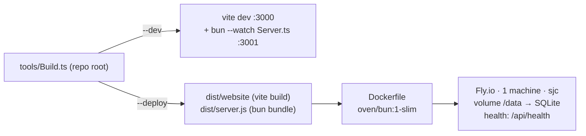

# KHL+ architecture

KHL+ is a faster, friendlier front end for [krakenhockeyleague.com](https://krakenhockeyleague.com). The league has no API, so a Bun/Express server scrapes its HTML pages, stores every page it fetches, parses and caches them in memory, joins them with LiveBarn's venue data and a small SQLite database, and serves typed JSON to a React single-page app.

## Components

| Component | Files | Responsibility |
| --- | --- | --- |
| Scraper | `src/server/KHL.ts` | One `getKHL*` per league page. Each fetches through `fetchKHLPage`, which rate-limits `doFetch` per lane (2 requests a second for visitors, 1 for background work run through `runInKHLBackground`), and hands the DOM to a pure `parseKHL*` that returns a `KHLJson` shape or throws `newParseError`. Knows nothing about caching or the API. |
| LiveBarn client | `src/server/LiveBarn.ts` | Fetches the venues list (validated by `LiveBarnJson.ts`). The live/VOD watch URLs are built by `src/shared/LiveBarn.ts`, so the client can link scoresheet events to their moment in a replay. |
| Arena mapping | `src/server/Arenas.ts` | Hand-maintained map from KHL arena id to LiveBarn surfaces, display name, and city. The two sites disagree on names and addresses, so nothing here is inferred. |
| Page store | `src/server/PageStore.ts` | Every page fetched from the KHL (`khl_pages`) and LiveBarn (`livebarn_responses`), as fetched and gzipped, in its own SQLite file (`KHL_SOURCES_DB_PATH`). It's a copy of the sources, not a cache: nothing expires, and a refetch replaces a page, recording whether it changed. Fetches read through it (`readPage`), so a recent enough stored page saves a fetch. |
| Cache | `src/server/Cache.ts` | `KHLCache`: parsed KHL and LiveBarn data in memory, by key and TTL, sharing in-flight loads. A load reads stored pages up to the TTL old, so after a restart it parses them again instead of fetching. |
| App cache | `src/server/AppCache.ts` | Values we compute from fetched pages, like each season's player list, in the main database (`app_cache`, gzipped). They don't expire: whatever computes one replaces it, and its schema is checked when it's read back. |
| Background sync | `src/server/KHLSyncer.ts` | Keeps a copy of every page behind the player pages: each season's teams, each team's schedule and stats, each rostered player's page, and each finished game's box score and lineups. It walks the current season first, then the rest newest first, fetching only the pages that are due, and builds each season's player list (`players:<season>`) into the app cache when a roster changes. See seam 2. |
| Games tables | `src/server/GameRecords.ts`, `Database.ts` | `teams`, `games`, `game_goals`, `game_goal_assists`, `game_penalties`, and `game_lineups`, saved from each finished game's box score and stats page (`processGame`). Games refer to teams and players only by id; names and logos come from joins with `teams` and `registrations`. Activity is a query on these tables. |
| API server | `src/server/Server.ts` | Express app. Picks each page's TTL and schema, composes scraped pages into API responses, enriches them (LiveBarn links, logos, preview stats, rosters), serves the built SPA, and maps errors to status codes. |
| Database | `src/server/Database.ts` | `bun:sqlite` with append-only migrations. Stores the person-level player identity the KHL lacks, status-check history, the app cache, and the games tables. Fetched pages are in a separate file (see Page store), since they can always be fetched again and these can't. |
| Status monitor | `src/server/Status.ts` | On boot and every 5 minutes, checks the app/DB, the KHL site, and LiveBarn, records results, and prunes to 90 days. Serves `/api/status` and `DEPLOY_INFO` (git commit). |
| Shared contracts | `src/shared/*` | `ApiJson.ts` defines every endpoint (`uri`, `method`, and request and response zod schemas). `KHLJson.ts` is the scraper's output vocabulary. `KHLConfig.ts` holds strings, URLs, league settings, and limits. `LeagueTime.ts` is the only place that knows the league's time zone, and it estimates when a scoresheet event happened from its period and clock (`getGameEventClockTime`). `LiveBarn.ts` builds watch URLs. |
| Client shell | `src/client/App.tsx`, `Util.ts` | Hand-rolled router over `history` (a `ROUTES` table and `matchRoute`), `AppContext`, per-route `ErrorBoundary`, React root error hooks, and client logging. |
| UI kit | `Components.tsx`, `Games.tsx`, `Compare.tsx`, `Styles.css` | Generic controls built on Base UI (`Picker`, `SegmentedControl`, `Hint`, `AsyncContent`, `PageShell`), game-specific views (`GameTable`, `GameCards`, `TeamForm`), and the matchup comparison bars. |
| Pages | `src/client/pages/*.tsx` | One `Route` per file: `/`, `/games`, `/games/:gameId`, `/players`, `/players/:playerId`, `/teams`, `/teams/:teamId`, `/rinks/:arenaId`, `/matchup`, `/about`, `/help`, `/api` (docs rendered from the `ApiJson.ts` endpoint objects), `/status`, and `/admin` (dev only). |

## Seams

These are the boundaries where one part of the system meets another. Most changes stay on one side of a seam. A change that crosses one usually has to touch both sides together.

### 1. Client ↔ server: `ApiJson.ts` endpoint contracts

Both sides import the same `*_ENDPOINT` object, so a route, its parameters, and its response type can't drift silently: the server validates the request on the way in and its own response on the way out. To add an API, define the endpoint in `ApiJson.ts`, register it in `Server.ts`, and call it with `doRequest` inside `useAsync`. Every endpoint also needs a `name`, a `description`, and an `exampleRequest`, and its request fields need `.describe()`. The `/api` docs page renders all of that, plus TypeScript types generated from the zod schemas, for each endpoint in `API_DOCS_SECTIONS`. `ApiDocs.test.ts` fails if an endpoint is in neither that list nor its internal list.

In dev, Vite serves the client on `:3000` and proxies `/api` to the server on `:3001`. In production, one process serves both: `express.static(dist/website)` with an `index.html` fallback for client routes.

### 2. Scraper ↔ server: `KHLJson.ts` and `KHLCache`

`KHL.ts` turns HTML into `KHLJson` types and does nothing else. `Server.ts` never touches the DOM, and `KHL.ts` never caches or builds API responses. Every scraper call goes through `cache.cached(key, ttl, load)`. That method:

- shares one in-flight promise between concurrent callers,
- drops failures so the next request retries,
- takes a TTL per key: `getSeasonTtl(isCurrentSeason)` caches the current season for 10 minutes and past seasons for 24 hours. An optional `getTtlMs` can also set the TTL from the loaded value,
- reads stored pages up to `ttl` old through the page store, so a deploy parses what's stored instead of fetching it again. `invalidate(key)` makes the next load fetch.

When the league changes its markup, the fix belongs in the matching `parseKHL*`. When a response needs new data, add a field to `KHLJson.ts` and then use it from `Server.ts`.

The KHL site starts returning 403s at a few requests a second, counting all of ours together, so `fetchKHLPage` has a rate limiter for each lane. A fetch for a visitor waiting on an uncached page gets up to 2 a second. Background work (anything inside `runInKHLBackground`) gets 1 a second on its own limiter, so visitors never queue behind it. Anything that reads many pages runs in the background instead of in a request.

`KHLSyncer` keeps a copy of every page behind the player pages, in the background lane. Each page decides for itself whether it's due, from when the page store says it was fetched:

| Page | Due when |
| --- | --- |
| Teams, schedules, team stats, and player pages | Never fetched, or older than 6 hours (current season) or 30 days (past seasons) |
| A team's schedule and stats | A game on its schedule has ended (plus 30 minutes to settle) since they were fetched |
| A player's page | A game they dressed for on that team has ended since it was fetched |
| A finished game's box score and lineups | Never fetched, fetched before the game settled, or every 10 minutes for 2 days while the summary or a lineup isn't posted |

The syncer walks the current season, then past seasons newest first: each season's teams, then each team's schedule, stats, finished games, and players. It fetches only what's due, so a restart or deploy just walks again and skips what's fresh, and a failed page waits 30 minutes (a day for past seasons) without stopping the walk. Each walk notes when the season's next page is due, so seasons with nothing due are skipped, and while a long past-season walk runs, it checks every 5 minutes for current-season games that just ended. A season's player list is rebuilt from the stored stats pages whenever a roster was fetched. `/api/players` serves that list, or a 503 before a season's first build, and never fetches itself.

Visitors read the same stored pages. Player pages, schedules, and team stats are read up to twice the sync interval old (12 hours, or 60 days for past seasons), so visitors don't refetch what the syncer keeps fresh, while their short memory TTL picks up its refreshes within minutes.

### 3. KHL ↔ LiveBarn: `Arenas.ts` with runtime verification

The two external sites share no ids. `Arenas.ts` is the join table. It records the expected names on both sides, so if either site renames or reassigns an id, the link is dropped and logged instead of pointing viewers at the wrong rink. Watch URLs use league-local date and time, which works because every mapped venue is in the league's time zone.

### 4. Scraped ids ↔ stable people: `Database.ts`

The KHL issues a new player id each time a player registers, so one person has many ids, including several on one team when they re-register with it. A player can also keep one id across several teams, so a registration is a (KHL player id, team) pair, identified by a `RegistrationKey` (`toRegistrationKey`), which is how one is passed around, e.g. to `getPlayer`. Search results, rosters, and box scores all pass through `db.recordRegistrations(...)`, which matches each KHL id to a person-level UUID by normalized name (`normalizePlayerName`). `/players/:playerId` uses that UUID and fans out to all of the person's registrations. The database lives on a Fly volume (`KHL_DB_PATH`), so those UUIDs survive deploys. Migrations in `MIGRATIONS` are append-only, and their order is tracked with `PRAGMA user_version`.

#### Building a player profile

A player gets a UUID the first time a roster, box score, or search shows them. The syncer reads every season's rosters, so the database holds each person's registrations across seasons, and a profile is built from what's stored, without searching the KHL:

`GET /api/players/:playerId` reads, in this order:

Opponent logos come from the teams page already loaded. The page also requests `GET /api/players/:playerId/activity` once, separately. That one response feeds the activity feed, the games the player sat out, and the badges' penalty trend. It reads the same registrations and schedules, then queries the games tables for the recent finished games: goals, assists, and penalties by the player's KHL ids, and lineups for whether they dressed. A game that isn't in the tables yet, or was saved before its summary or lineups were posted, is processed from its pages first. The integrity report (`/players/:playerId?integrity`) still searches the KHL by name, since it checks what we've stored against the KHL.

### 5. League time: `LeagueTime.ts`

The schedule lists local dates and times with no zone. `toLeagueInstant` converts them to ISO instants at parse time, `getLeagueDayKey` buckets instants into league days (used for `/api/games?date=` and status history), and `getGameEndsAt` / `isGameInProgress` apply `LEAGUE.GAME_DURATION_MINUTES`. Both the server and the client import these functions, so "today" and "live now" mean the same thing on both sides.

### 6. Failure handling across the stack

A 502 means the KHL or LiveBarn site failed. A 500 means a bug in our code. Optional enrichments never fail a whole page. Client logs are batched, flushed when the tab is hidden, and re-logged on the server under `client.<context>`, so one log stream covers both sides.

## Build and deploy

`pnpm start` / `build` / `deploy` all go through the repo's `tools/Build.ts`. The production image contains only Bun and the two bundled artifacts. `tools/Benchmark.ts` is dev-only: it uses Puppeteer to time KHL+ against the league's own site, runs from the CLI or from `/admin` via `/api/admin/benchmark`, and is imported lazily so it stays out of the production bundle.
